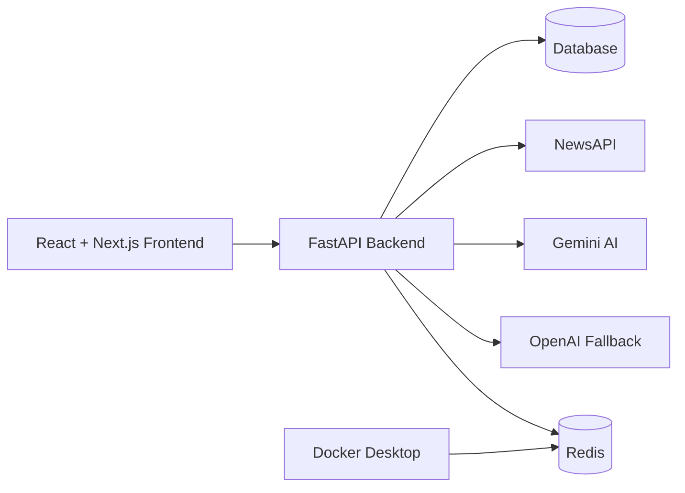

# MarketFlow

MarketFlow is an AI-powered equity research platform that helps users discover financial news, analyze companies, compare stocks, manage watchlists, and generate research reports from one workspace.

## Features

- Public market news feed available before signing in
- Personalized news based on searches and watchlist companies
- Company search and financial overviews
- Technical stock analysis with trends, indicators, volatility, and signals
- Company comparison tools
- Personal watchlists
- Downloadable research reports
- AI-powered MarketFlow Bot
- PDF and DOCX document uploads
- Document chunking for efficient AI follow-up questions
- Conversation history and assistant memory
- Light and dark mode
- Premium orange-and-white visual design
- Login and signup authentication
- One-hour authenticated sessions with logout support
- Protected research features for authenticated users

## Tech Stack

### Frontend

- React
- Next.js (React framework)
- TypeScript
- Tailwind CSS
- shadcn/ui
- Lucide Icons
- Axios
- KaTeX and remark-math for mathematical formatting

### Backend

- Python
- FastAPI
- SQLAlchemy
- Pydantic
- Async database operations
- PDF and DOCX document extraction
- NewsAPI
- Gemini AI
- OpenAI fallback support

### Infrastructure

- Docker Desktop
- Redis using the `redis:8-alpine` image
- Redis exposed on port `6379`
- n8n as an optional workflow-automation container

Redis is available as local infrastructure for caching and short-lived backend data. It participates in application behavior only when the backend is explicitly configured to connect to and use Redis.

## Architecture



## Project Structure

```text
MarketFlow/
├── backend/
│   ├── app/
│   │   ├── api/
│   │   ├── core/
│   │   ├── db/
│   │   ├── models/
│   │   ├── rag/
│   │   ├── schemas/
│   │   └── services/
│   ├── requirements.txt
│   └── .env
│
├── frontend/
│   ├── app/
│   ├── components/
│   ├── lib/
│   ├── public/
│   ├── package.json
│   └── .env.local
│
├── MarketFlow_Architecture.txt
└── README.md
```

## Getting Started

### Requirements

- Node.js 18 or later
- Python 3.11 or later
- Docker Desktop
- NewsAPI key
- Gemini API key
- OpenAI API key for fallback support

### 1. Clone the repository

```bash
git clone https://github.com/Divyanshu2529/MarketFlow.git
cd MarketFlow
```

### 2. Configure the backend

```bash
cd backend
python -m venv venv
source venv/bin/activate
pip install -r requirements.txt
```

Create a `backend/.env` file:

```env
DATABASE_URL=your_database_url
SECRET_KEY=your_secret_key
NEWS_API_KEY=your_newsapi_key
GEMINI_API_KEY=your_gemini_api_key
OPENAI_API_KEY=your_openai_api_key
REDIS_URL=redis://localhost:6379/0
```

The exact environment variable names must match the names used by the backend source code.

Never commit `.env` files or API keys to GitHub.

### 3. Start Redis with Docker

If the Redis container has not been created yet, run:

```bash
docker run --name marketflow-redis \
  -p 6379:6379 \
  -d redis:8-alpine
```

If the container already exists but is stopped, run:

```bash
docker start marketflow-redis
```

Check the running containers:

```bash
docker ps
```

Redis will be available at:

```text
redis://localhost:6379/0
```

### 4. Configure the frontend

Create `frontend/.env.local`:

```env
NEXT_PUBLIC_API_URL=http://localhost:8000
```

Install the frontend dependencies:

```bash
cd ../frontend
npm install
```

### 5. Start the backend

Open a terminal and run:

```bash
cd backend
source venv/bin/activate
python -m uvicorn app.main:app --reload --port 8000
```

The backend will run at:

```text
http://localhost:8000
```

### 6. Start the frontend

Open another terminal and run:

```bash
cd frontend
npm run dev
```

The frontend will run at:

```text
http://localhost:3000
```

## Usage

Visitors can view the public dashboard and current market news without creating an account.

Authentication is required for:

- Company research
- Stock analysis
- Company comparisons
- Watchlists
- Saved reports
- MarketFlow Bot
- Personalized news

After signing in, users can search for companies, add companies to their watchlist, analyze stocks, upload documents, and ask follow-up questions about their research.

## AI Document Workflow

MarketFlow processes uploaded PDF and DOCX files through the following workflow:

1. Extract text from the uploaded document
2. Split the document into smaller chunks
3. Retrieve only relevant chunks for each question
4. Send the relevant context to the AI model
5. Return a concise answer using the retrieved document content

This reduces unnecessary token usage compared with sending the entire document with every question.

## Docker and Redis

Docker Desktop provides the local container runtime for supporting services.

The MarketFlow environment includes a Redis container using:

```text
redis:8-alpine
```

The Redis port mapping is:

```text
6379:6379
```

Redis can be used for:

- Shared caching
- Temporary session data
- Rate-limit counters
- Short-lived task state
- Communication between backend processes

If the backend runs directly on the host machine, use:

```env
REDIS_URL=redis://localhost:6379/0
```

If the backend runs inside Docker Compose, use the Redis service name instead of `localhost`, for example:

```env
REDIS_URL=redis://redis:6379/0
```

The n8n container is an optional workflow-automation service. It is separate from the core MarketFlow request flow unless the backend is explicitly connected to n8n.

## Important API Groups

### Authentication

- `POST /api/auth/signup`
- `POST /api/auth/login`
- `POST /api/auth/logout`
- `GET /api/auth/me`
- `PATCH /api/auth/me`
- `PATCH /api/auth/me/email`
- `POST /api/auth/forgot-password`
- `POST /api/auth/reset-password`

### News

- `POST /api/news/interests`
- `GET /api/news/feed`
- `GET /api/news/public-feed`

### Watchlist

- `GET /api/watchlist`
- `POST /api/watchlist`
- `DELETE /api/watchlist/{ticker}`

### Reports

- `GET /api/reports`
- `GET /api/reports/{report_id}`
- `POST /api/reports`
- `DELETE /api/reports/{report_id}`
- `GET /api/reports/{report_id}/download`

### Assistant

- `POST /api/assistant/documents`
- `POST /api/assistant/chat`
- `GET /api/assistant/conversations`
- `POST /api/assistant/conversations`
- `GET /api/assistant/conversations/{conversation_id}`
- `DELETE /api/assistant/conversations/{conversation_id}`
- `POST /api/assistant/conversations/{conversation_id}/messages`

## Security Notes

- API keys remain on the backend.
- Protected data is filtered by the authenticated user ID.
- Users cannot access another user's conversations, reports, or watchlist.
- Uploaded documents are validated by type and size.
- Authentication sessions expire after one hour.
- AI responses are not guaranteed to be accurate.
- Technical stock signals are educational indicators, not financial advice.

Never commit:

- API keys
- Passwords
- Database credentials
- Secret signing keys
- `backend/.env`
- Secret values inside `frontend/.env.local`

## Limitations

- News availability depends on NewsAPI limits and provider availability.
- Some article images or external links may be unavailable.
- AI responses may contain errors and should be verified.
- External AI and market data services may impose quotas or rate limits.
- Public news is general market news and is not personalized for guests.
- Redis only affects application behavior when the backend explicitly connects to and uses it.

## Author

Built by [Divyanshu Mehta](https://github.com/Divyanshu2529).
