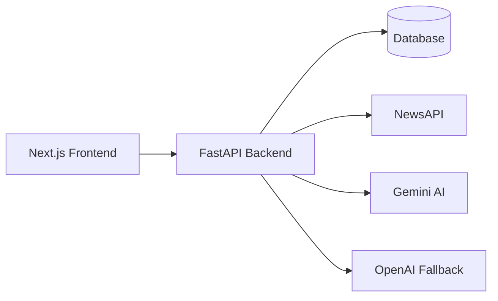

# MarketFlow

MarketFlow is an AI-powered equity research platform that helps users discover financial news, analyze companies, compare stocks, manage watchlists, and generate research reports from one workspace.

## Features

- Public market news feed available before signing in
- Personalized news based on searches and watchlist companies
- Company search and financial overviews
- Technical stock analysis with price trends, indicators, volatility, and signals
- Company comparison tools
- Personal watchlists
- Downloadable research reports
- AI-powered MarketFlow Bot
- PDF and DOCX document uploads
- Document chunking for efficient AI follow-up questions
- Conversation history and assistant memory
- Light and dark mode with a premium orange-and-white design
- Login and signup authentication
- One-hour authenticated sessions with logout support
- Protected research features for authenticated users

## Tech Stack

### Frontend

- Next.js
- React
- TypeScript
- Tailwind CSS
- shadcn/ui
- Lucide Icons
- Axios
- KaTeX and remark-math for mathematical formatting

### Backend

- Python
- FastAPI
- SQLAlchemy
- Pydantic
- Async database operations
- PDF and DOCX document extraction
- NewsAPI
- Gemini AI
- OpenAI fallback support

## Architecture



## Project Structure

```text
MarketFlow/
├── backend/
│   ├── app/
│   │   ├── api/
│   │   ├── core/
│   │   ├── db/
│   │   ├── models/
│   │   ├── rag/
│   │   ├── schemas/
│   │   └── services/
│   ├── requirements.txt
│   └── .env
│
├── frontend/
│   ├── app/
│   ├── components/
│   ├── lib/
│   ├── public/
│   ├── package.json
│   └── .env.local
│
└── README.md
```

## Getting Started

### Requirements

- Node.js 18 or later
- Python 3.11 or later
- NewsAPI key
- Gemini API key
- OpenAI API key for fallback support

### 1. Clone the repository

```bash
git clone https://github.com/Divyanshu2529/MarketFlow.git
cd MarketFlow
```

### 2. Configure the backend

```bash
cd backend
python -m venv venv
source venv/bin/activate
pip install -r requirements.txt
```

Create a `backend/.env` file and add the environment variables used by the application:

```env
DATABASE_URL=your_database_url
SECRET_KEY=your_secret_key
NEWS_API_KEY=your_newsapi_key
GEMINI_API_KEY=your_gemini_api_key
OPENAI_API_KEY=your_openai_api_key
```

Never commit `.env` files or API keys to GitHub.

### 3. Configure the frontend

Create `frontend/.env.local`:

```env
NEXT_PUBLIC_API_URL=http://localhost:8000
```

Install the frontend dependencies:

```bash
cd ../frontend
npm install
```

### 4. Start the backend

Open a terminal and run:

```bash
cd backend
source venv/bin/activate
python -m uvicorn app.main:app --reload --port 8000
```

The backend will run at:

```text
http://localhost:8000
```

### 5. Start the frontend

Open another terminal and run:

```bash
cd frontend
npm run dev
```

The frontend will run at:

```text
http://localhost:3000
```

## Usage

Visitors can view the public dashboard and current market news without creating an account.

Authentication is required for:

- Company research
- Stock analysis
- Company comparisons
- Watchlists
- Saved reports
- MarketFlow Bot
- Personalized news

After signing in, users can search for companies, add companies to their watchlist, analyze stocks, upload documents, and ask follow-up questions about their research.

## AI Document Workflow

MarketFlow processes uploaded PDF and DOCX files through the following workflow:

1. Extract text from the uploaded document
2. Split the document into smaller chunks
3. Retrieve only relevant chunks for each question
4. Send the relevant context to the AI model
5. Return a concise answer using the retrieved document content

This reduces unnecessary token usage compared with sending the entire document with every question.

## Important Notes

- AI-generated responses may contain mistakes.
- MarketFlow is for research and educational purposes only.
- Nothing on this platform should be considered guaranteed financial advice.
- Always verify important financial information independently.
- API keys must remain private and should never be committed to the repository.

## Author

Built by [Divyanshu Mehta](https://github.com/Divyanshu2529).
